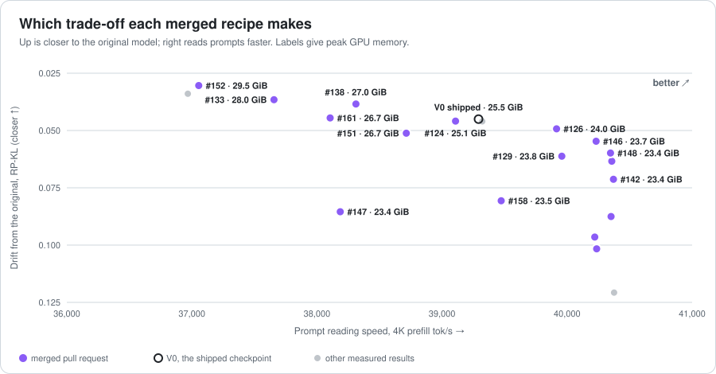
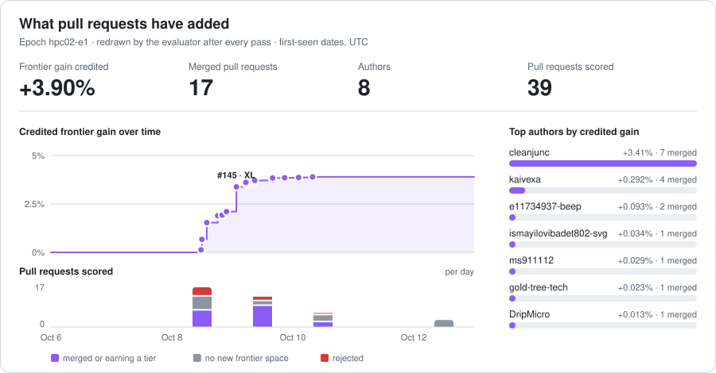

# BitTrellis score records (hpc02-e1)

> Every evaluated pull request, the frontier it was ranked against, and the artifacts behind both.

## Which checkpoint to use

Every merged recipe trades a little of one thing for another. Pick by what you need; each change is against today's shipped checkpoint (V0).



| Best for | Recipe | Closeness to the original (RP-KL) | Prompt reading, 4K | Peak GPU memory |
|---|---|---|---|---|
| **Closest to the original model** | `ud-exps-q5k-downs-q6k-kq-imat-lmhead-q8`<br>#152 by @e11734937-beep  | **0.0304 · 32.6% closer** | 37,055 tok/s · 6% slower | 29.46 GiB · 3.96 GiB more |
| **Fastest prompt reading** | `pr142-attention-qo-11-39-kq-imat`<br>#153 by @cleanjunc  | 0.0634 · 40.8% further | **40,358 tok/s · 3% faster** | 23.32 GiB · 2.18 GiB less |
| **Least GPU memory** | `pr147-shallow-zo-q5k-downs-q4k`<br>#156 by @DripMicro  | 0.0876 · 94.4% further | 40,352 tok/s · 3% faster | **23.21 GiB · 2.30 GiB less** |
| *for reference* | V0, today's shipped checkpoint | 0.0450 | 39,292 tok/s | 25.51 GiB |

Build one yourself (after `scripts/setup_models.sh` in [bittrellis](https://github.com/coderbench/bittrellis)):

```bash
bittrellis build manifests/ud-exps-q5k-downs-q6k-kq-imat-lmhead-q8.yaml --out models/ud-exps-q5k-downs-q6k-kq-imat-lmhead-q8
bittrellis build manifests/pr142-attention-qo-11-39-kq-imat.yaml --out models/pr142-attention-qo-11-39-kq-imat
bittrellis build manifests/pr147-shallow-zo-q5k-downs-q4k.yaml --out models/pr147-shallow-zo-q5k-downs-q4k
```

## Progress



## Every measured result

Written by the evaluator after each pass. Re-derive any score yourself:

```bash
bittrellis --track HPC-02 frontier hpc02-e1/accepted <your artifact>
```

| | Checkpoint | RP-KL ↓ | tasks ↑ | decode tok/s ↑ | prefill 4K tok/s ↑ | peak GPU GiB ↓ | holdout | FG-2 |
|---|---|---:|---:|---:|---:|---:|---|---:|
| ★ | ud-exps-q5k-downs-q6k-kq-imat-lmhead-q8 | 0.0304 | 565/784 | 384.5 | 37,055 | 29.46 | PASS | 0.063% |
| ★ | V3-exps-q5k-down-q6k | 0.0340 | 564/784 | 384.5 | 36,967 | 29.24 | PASS | 0.000% |
|   | ud-exps-gate-up-q5k | 0.0366 | 562/784 | 387.9 | 37,656 | 28.01 | PASS | 0.000% |
| ★ | ud-downs-q6k-imat-lmhead-q8 | 0.0384 | 566/784 | 394.3 | 38,312 | 26.96 | PASS | 0.026% |
| ★ | pr151-kq-imatrix-downs-qkv | 0.0445 | 570/784 | 420.9 | 38,105 | 26.65 | PASS | 0.031% |
|   | V0-unsloth-ud | 0.0450 | 570/784 | 398.5 | 39,292 | 25.51 | — | 0.000% |
| ★ | ud-lmhead-q4k-embed-q4k | 0.0459 | 566/784 | 399.3 | 39,108 | 25.12 | PASS | 0.002% |
|   | V1-kq-rtn-udmap | 0.0460 | 563/784 | 398.7 | 39,322 | 25.51 | PASS | 0.000% |
| ★ | ud-downs-q4k-lmhead-embed-q4k | 0.0493 | 570/784 | 404.5 | 39,916 | 23.96 | PASS | 0.024% |
|   | ud-exps-gate-up-q5k-downs-gdn-qkv-q4k-kq-imat-lmhead-q8 | 0.0512 | 564/784 | 421.2 | 38,715 | 26.65 | PASS | 0.000% |
| ★ | pr129-kq-imatrix-downs-gdn-qkv | 0.0547 | 561/784 | 432.8 | 40,232 | 23.73 | PASS | 0.023% |
| ★ | pr142-kq-imat | 0.0598 | 567/784 | 448.1 | 40,348 | 23.42 | PASS | 0.013% |
|   | ud-downs-q4k-gdn-qkv-q4k-lmhead-embed-q4k | 0.0612 | 565/784 | 432.5 | 39,958 | 23.81 | PASS | 0.000% |
| ★ | pr142-attention-qo-11-39-kq-imat | 0.0634 | 563/784 | 460.9 | 40,358 | 23.32 | PASS | 0.075% |
|   | pr129-recurrent-zo-deep-downs-q4k | 0.0713 | 565/784 | 448.5 | 40,371 | 23.42 | PASS | 0.000% |
| ★ | pr147-kq-imatrix-downs-qkv | 0.0807 | 563/784 | 475.4 | 39,474 | 23.48 | PASS | 0.016% |
|   | pr145-kq-imat | 0.0855 | 567/784 | 475.4 | 38,186 | 23.40 | PASS | 0.000% |
| ★ | pr147-shallow-zo-q5k-downs-q4k | 0.0876 | 562/784 | 475.3 | 40,352 | 23.21 | PASS | 0.008% |
|   | pr129-recurrent-zo-q4k | 0.0965 | 570/784 | 460.9 | 40,222 | 23.49 | PASS | 0.000% |
|   | pr130-attention-qo-11-39-q4k | 0.1016 | 566/784 | 475.8 | 40,237 | 23.40 | PASS | 0.000% |
|   | V2-all-q4k | 0.1207 | 573/784 | 468.0 | 40,376 | 23.25 | PASS | 0.000% |

Epoch `hpc02-e1` · rules: [bittrellis](https://github.com/coderbench/bittrellis) ([specification](https://github.com/coderbench/bittrellis/blob/main/docs/specification.md)).

`results/` holds one record per evaluated pull-request head -- never rewritten, with any re-measurement published beside it as `.remeasured-N` -- `observations/` the first-seen record that decides who submitted a recipe first, and `accepted/` the artifacts of merged results. The private holdout never appears here: records carry PASS or FAIL only.
